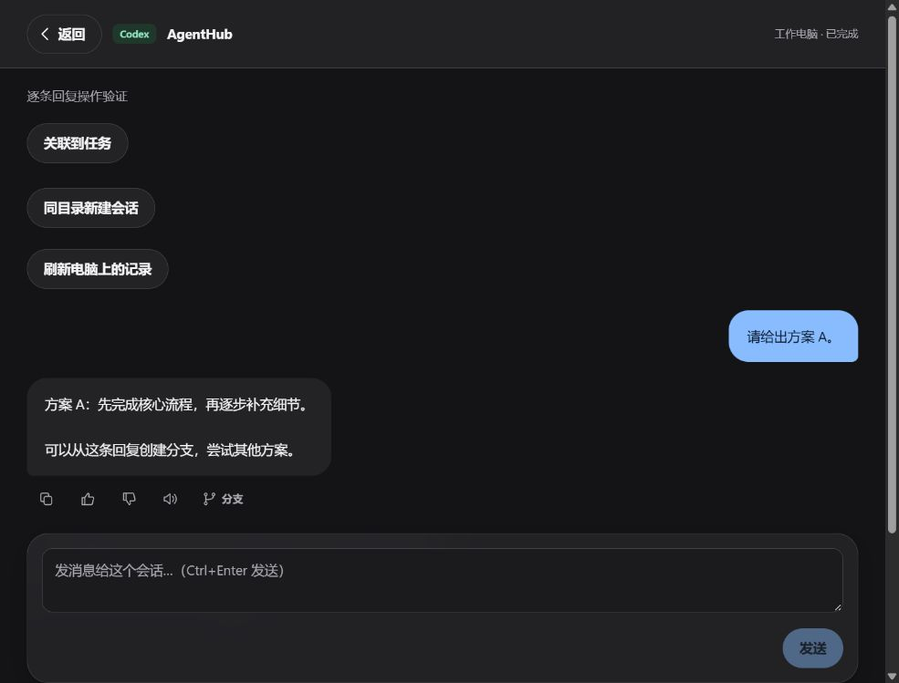
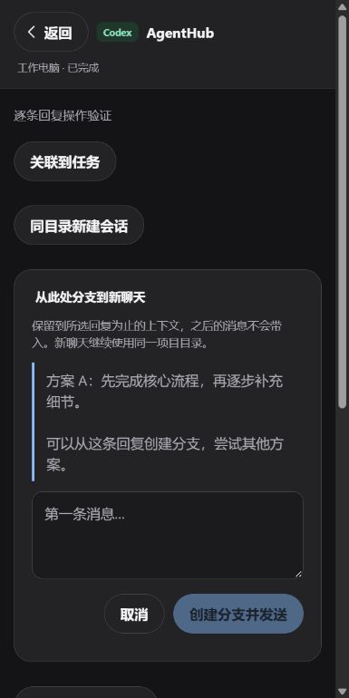

# 逐条回复操作

日期：2026-11-02。

## 行为

- 助手回复下显示复制、有帮助、没帮助、朗读／停止、从此处分支。
- 评价可切换或取消，保存在 AgentHub 内，不提交给模型提供商。按原始消息标识持久化，同文本的不同回复不共享评价；同步历史替换数据库编号后评价仍保留。
- Windows / 浏览器使用 Web Speech；Android 提供系统 TTS 和剪贴板桥，按短段朗读，支持切换回复、停止、离开页面停止。没有语音能力或语言包时提示错误。
- 分支先选择回复、填写新消息，再创建新会话。上下文截止于选中的完整回复，后续回复不会被带入。分支不回滚文件，仍在同一项目目录运行。
- Claude Code：`--resume <session> --fork-session --resume-session-at <assistant UUID>`。Codex：`thread/fork {threadId,lastTurnId}`。执行器再次从本机历史确认节点属于原会话，失败则停止，不回退到整个会话分叉。
- 顶部只保留从零开始的“同目录新建会话”。最后一条完整回复处分支即覆盖原整会话分叉用途。工具中间消息、未完成回复、缺少原生标识的旧历史不允许分支，需刷新记录或等待完成。
- 必须同时更新服务端和电脑执行器；旧电脑端未声明 `reply-branch-v1` 能力时拒绝指定回复分支。

## 验证

- 服务端检查通过；回归测试 54/54：原始标识、重复文本评价隔离、账号隔离、历史刷新保留评价、只传选中节点、拒绝旧电脑端与无效节点。
- Rust 52/52：历史解析、已完成回复边界、原生命令参数及原有执行/授权测试。
- 前端 9/9：评价广播在慢快照期间不丢失；Unicode 长文本朗读分段、切换回复阻止旧回调继续、错误恢复与能力缺失。
- 隔离浏览器 UI：1000×760 和 400×800 无横向溢出；复制内容正确，评价选中状态更新，朗读可切换至停止；从早期回复分支发送该条编号而非最后一条。剪贴板与语音在此 UI 测试中使用模拟实现。
- `server/tools/verify-reply-branch.mjs`：实际运行本机 Claude Code 与 Codex app-server，使用生成的临时会话。Codex 原生 `lastTurnId` 与 Claude 原生 `--resume-session-at` 均生成新 id，分支只含 EARLY_ONLY，不含 LATER_ONLY；原会话文件 SHA-256 保持不变。Claude 模型请求只发到本机模拟接口，无真实模型消费。
- 成功探针目录：系统临时目录下的 `agenthub-reply-branch-KfQWqU`。未读取、修改或归档用户真实会话，未修改已安装应用配置、hook 或模型配置。
- 未进行 Android 真机 TTS 出声验收；具体可用声音取决于系统语音引擎和语言包。

## 官方资料

- [Claude Agent SDK reference](https://code.claude.com/docs/en/agent-sdk/typescript)：`resumeSessionAt` 与分支会话选项。
- [Codex App Server](https://learn.chatgpt.com/docs/app-server)：`thread/fork.lastTurnId` 仅保留至指定完成轮次。

## 交付

文件位于 `artifacts.local/reply-actions/`：Windows 安装程序、Android arm64 APK、服务端更新源码包、完整源码快照及 `checksums.json`。完整源码快照以 `53f96da` 为基础，仅加入本次回复操作功能，排除同工作区其他任务的并行改动。

Windows 与 Android release 构建均已完成。Android 隔离构建复用 Rust 缓存时缺失自动生成的 `TauriActivity.kt`，补齐同版本生成文件后重试成功。

安装包需要配套更新服务端与电脑执行器。尚未部署生产服务、安装到用户设备，也未提交 Git；共享工作区中的并行改动保留原状。

## 界面

