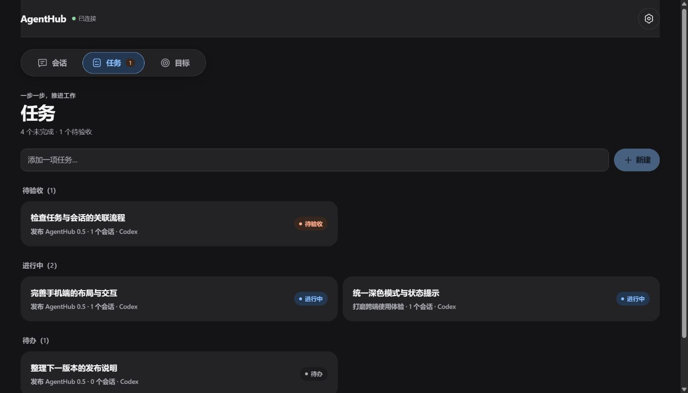
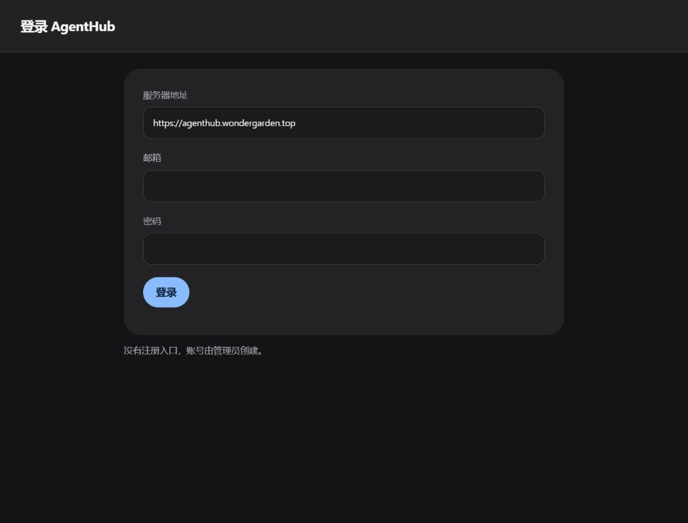

# UI 更新与验证

日期：2026-11-01。

参考 Apple 当前 [Materials](https://developer.apple.com/design/human-interface-guidelines/materials)、[Typography](https://developer.apple.com/design/human-interface-guidelines/typography) 与 [Accessibility](https://developer.apple.com/design/human-interface-guidelines/accessibility) 指南，适配现有 React / Tauri 的 Windows 与 Android 界面。这是 WebView 内的设计实现，不是原生 Apple Liquid Glass，也不代表通过了苹果的完整合规认证。

## 已实现

- 导航与输入工具栏使用半透明材质；内容使用实色表面，避免文字叠在复杂背景上。
- 桌面顶部胶囊导航、宽屏双列内容；600px 以下改为底部悬浮导航并预留安全区。
- 统一系统字体、标题层级、间距、圆角、语义颜色、任务状态和目标进度。
- 任务页先展示待验收，再展示进行中和待办。
- 统一任务/目标表单、会话气泡、授权提示、登录与设置样式。
- 按钮最小高度 44 CSS px，提供键盘焦点、可访问标签和原生表单语义；会话入口和摘要展开改为可键盘操作的按钮。
- 适配浅色/深色、减少动态效果、减少透明度、高对比度及强制颜色模式。媒体查询是否生效取决于 WebView 对系统偏好的支持。

## 验证

- `npm run build`：通过，TypeScript 检查与 Vite 打包成功。
- `npm test`：6/6 通过。
- `git -c core.safecrlf=false diff --check`：通过。
- 浏览器视觉检查：1400×800 桌面深色、400×800 手机浅色与深色，任务列表、任务详情和目标列表无横向溢出。
- 隔离的内存数据验证：任务详情编辑/保存出现“已保存”；返回任务列表保留修改；Tab 导航显示清晰焦点；目标进度正确显示。
- 截图使用模拟数据，不连接生产服务，不读取或改写已安装应用的配置。

未进行手机软键盘、原生 WebView 与屏幕阅读器的完整验收。

## 提交与重新打包

任务管理和初版 UI 实现已提交：`58a3cfe`。后续窗口与横栏修正见下节。以下为最新 0.5.0 产物；没有推送、部署或覆盖安装用户现有应用。

| 产物 | 文件 | 大小 |
|---|---|---|
| Windows x64 安装包 | `src-tauri/target/release/bundle/nsis/AgentHub_0.5.0_x64-setup.exe` | 2,200,354 字节 |
| Android ARM64 APK | `src-tauri/gen/android/app/build/outputs/apk/universal/release/app-universal-release.apk` | 6,190,479 字节 |

- `npm run tauri build`：退出码 0。
- `npm run tauri android build -- --apk --target aarch64`：退出码 0；构建后 Gradle daemon 已停止。
- 两次构建的前端资源一致：`index-KTfpz9TY.css`、`index-PtwIyvKt.js`。
- APK 签名通过 `apksigner verify`；包名 `com.wenbo.agenthub`，版本 `0.5.0` / `5000`，架构 `arm64-v8a`。

SHA-256：

```text
Windows E6E6CC5C09AE60A418FCA07A9A33A63C7CA2432DAA4FD5279E89EF39C3A646F7
Android 2970F0B1FB6D03A2278C53B00E9B524E5E45E3659BE19AEFC43CE3602D710329
```

## 截图

以下任务页截图记录初版 UI；横栏铺满后的效果见下节。




## 窗口与横栏修正

- Windows 默认窗口从 `520×760` 调整为 `1000×760`，仍允许缩小到原有最小尺寸。
- 顶部横栏背景与底部分隔线铺满可用窗口宽度，内部控件保持与正文一致的内边距及安全区。
- 登录与设置页仅限制表单宽度，横栏不再受表单宽度限制。
- `npm run build` 通过。浏览器实测 `1000×760` 与 `400×800`：横栏左边界为 0，右边界分别为 1000 和 400，没有横向溢出。


